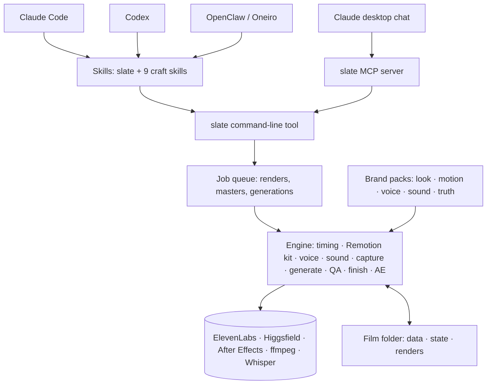

# Slate — Plan

*Working name, your call. Slate turns everything we built for the Vixa films into one reusable film studio that any of your agents can run, for any brand. Drafted 2026-09-30 from a full inventory of films A, B and C (8 readers, 306 components, plus web research on packaging, Remotion, ElevenLabs, Higgsfield and After Effects). Three independent reviewers then checked the draft against your exact words, the engineering and the craft. Their 44 findings are merged here.*

**Decided 2026-09-30:**
- **Name:** Slate.
- **After Effects:** a full creative engine. It finishes every film you supervise and is a second way to build scenes, using the AE bridge's 13 motion-design skills as looks.
- **Oneiro:** capped, and every film held for your approval.
- **Who it's for:** yours first, shareable later, with company brand packs on PERSONAL only.

## The promise

Five steps, then you just talk.

1. **Download.** One command clones Slate and runs its installer.
2. **Connect Claude.** Slate's skills, command-line tool and MCP server go into Claude Code, and into Codex and OpenClaw when they're on the machine.
3. **Connect Higgsfield.** You sign in yourself in Terminal; Slate never opens a browser for you. An optional Cloud API key goes into the Keychain.
4. **Connect ElevenLabs.** An API key, typed into Terminal (never into chat) and stored in the Keychain.
5. **Connect After Effects.** Slate finds AE and aerender, checks permissions and fonts, installs Higgsfield's AE bridge, and renders a 1-second smoke test. Building scenes in AE through the bridge needs AE's "Allow Scripts to Write Files and Access Network" pref. It's on (you turned it on on 2026-09-30), and Slate never changes it.

`slate doctor` then names anything missing, and goes green when nothing is. After that, you open a new Claude Code session (in Terminal or the desktop app's Code tab) and say "make a 45-second launch video for EOS". In a regular Claude chat, Slate can plan, write and voice a film, and with its desktop extension installed it can also start renders as background jobs.

**What you need first.** The five steps sit on top of a few things:

| Thing | Free or paid | Who sets it up |
|---|---|---|
| Homebrew tools: ffmpeg, Rubber Band (arm64), uv, Node ≥ 24 | Free | The installer, asking first |
| Whisper model (1.6 GB), Remotion engine and headless Chrome | Free | The installer, asking first |
| GarageBand's sound library (the sampled instruments proof 2's sound uses) | Free | You, from GarageBand's Sound Library |
| Xcode command-line tools (only for iOS app captures) | Free | You |
| After Effects | Paid (Creative Cloud) | You |
| AE's "Allow Scripts to Write Files and Access Network" pref (needed to build scenes in AE) | Free | You, in AE's scripting settings (done on this Mac) |
| ElevenLabs: Creator works; Pro or higher for lossless voice | Paid | You |
| Higgsfield Cloud API balance (plates, optional) | Paid, per generation | You |
| Remotion licence, only if a company's published film needs one (see Risks) | Free for individuals, pilots and teams of up to 3 | You, when you decide to publish |
| Brand fonts | Licensed per brand | The brand |

**What you approve.** Two sittings block a film: one pre-production sitting (the checklist, claims, script, voice shortlist and look test) and one final-cut sitting. Hero moments, plates and sound proofs arrive in review packets you can answer when you like; they don't block. A new brand also gets onboarded once (see §4).

**"Anything at once."** Three ways, all planned:
- **Inside a film:** act builders work in parallel wherever the agent can run sub-agents (Claude Code workflows do).
- **Across films:** one machine-wide job queue lets your EOS film and Oneiro's Inner Echo reel run on the same Mac without fighting over CPU, After Effects or API limits.
- **Express mode:** a short film runs straight through to a review cut, with its approvals batched at the end.

## What we're packaging

Of the 306 components the inventory found, **81 are reusable as they are and 127 once brand and film specifics are pulled out (68%)**. 54 only mean something for these three films, 28 are TrueSpace content and 16 are obsolete.

- **Visual engine.** One Remotion project with a shared kit: the film clock, the motion law, 2.5D paper cards, type, app UI primitives, the logo build, charts, and a character rig (Trudy's). `render_mb.mjs` renders true motion blur, 16 sub-frames averaged in 16-bit, straight into ProRes 422 HQ.
- **Timing.** `storyboard.json` → `shots.json` → `timeline.json`, anchored to Whisper word timings, so every move, sound and word share one clock.
- **Voice.** Casting shootouts, Voice Design with measured ranking, eleven_v4 with neighbouring-line context and audio tags, cleanup, pacing, alignment and captions.
- **Sound.** Proof 2's design, being perfected right now in `sound/p3/` with your notes:
  - event-tied wood, air, subs, small felt notes and pads, with tonal roles on real sampled instruments;
  - one deliberate sound per kind of interaction, with natural variation between repeats;
  - no glides, no slide-ups, no room-tone drone;
  - effects about 11 LU and UI clicks about 17 LU under the voice, every sound within a frame of its beat.

  That palette is a starting point: every brand gets its own during onboarding. A composed score is part of most films: Eleven Music on its best model, composed per act and assembled by measurement, never playing the effects' materials. From the retired v2 pass we keep its plumbing (`sound/v2/HANDOVER.md`): the beat schema, VO placement, `final_mix.py`, `verify_mix.py` and the gap check, plus its Eleven Music playbook (3-second pre-rolls, parts under 90 seconds, measured assembly, equal-power joins, freeze repairs).
- **After Effects.** An AEP built from data, chunked aerender masters, colour-managed (Rec.709 Gamma 2.4).
- **QA.** Film-level gates: read time by OCR, sync, loudness, banned words, the frame-glitch scan, master-vs-render PSNR and more.
- **Method.** Goals kept in the requester's own words, truth packs, look tests, kit-first foundations, parallel act builders with frame-exact contracts, review cuts.
- **Knowledge.** `MOTION.md`, `TRUDY_MOTION.md`, `SOUND.md`, `V4_TAGS.md`, 20 act `NOTES.md` files (3,565 lines) and the memory notes, most of it hard-won. `SOUND_V2.md` is kept as a record only.

Appendix A lists every library, CLI, MCP, skill and service we used, with a keep / depend / replace / drop decision for each. The full inventory lives in `research/video-package-inventory-2026-09-30/` in the film project.

## How it fits together



Eight principles:

1. **One source of truth, many front doors.** One git repo feeds Claude Code, Codex, OpenClaw and the Claude desktop app.
2. **CLI-first.** Every stage is a command. Oneiro's research agents can't see MCP servers, and every agent can run a shell command, so the CLI is the contract and MCP is a convenience.
3. **No brand in the core.** Brands are data packs, and every brand gets its own look. TrueSpace becomes one private pack.
4. **Film as data, one clock.** Sync is guaranteed by construction, not fixed after the fact.
5. **Gates, not vibes.** Every step with a measurable result is gated by a machine. The look, hero moments and final cut are judged by you. Nothing unchecked is ever reported as passed.
6. **Spend is explicit.** Estimates before generating, one ledger, a budget per film and per month. Slate never buys credits, upgrades a plan or starts a licence; when a balance runs out, the work stops and asks.
7. **People start After Effects, and nothing publishes itself.** AE finishes every film you supervise and builds scenes when a look calls for it. Oneiro's autonomous films never touch AE: Adobe's enterprise terms (PSLT §1.2) bar operations a person didn't start, and we treat that as the rule until your licence's terms are checked. When you approve a held film, you can start its AE finish yourself. Publishing always needs your yes.
8. **Perfect, don't replace.** Approved work plus notes means edits to that exact artifact. A redesign needs your yes.

## The pieces

### 1. Skills: what the agent knows

Ten focused skills in the open Agent Skills format, which Claude Code, Codex and OpenClaw all read.

| Skill | What it knows | Distilled from |
|---|---|---|
| `slate` (front door) | Intake, formats, routing, brand onboarding, approvals, budgets, the production tracker, `slate status` | GOAL/PRODUCTION trackers, goal-fidelity |
| `slate-story` | Treatment, script as data, truth packs, VO writing (≤ 2.6 words/s), one signature moment per act | storyboard gates, C's treatment and capability brief, visionary |
| `slate-motion` | The motion law, look and motion development, character and motif motion, anti-glitch rules, read time, safe areas | MOTION.md, TRUDY_MOTION.md, the glitch catalogue, act NOTES; The Browser Company's craft as the north star (the feeling, never their brand); the visionary bar; Material 3, IBM Carbon and Apple HIG as alternative motion systems; the 12 principles and UX in Motion |
| `slate-build` | Building scenes with the kit: act scaffolds and placeholders, contracts, events, hand-in checks, parallel builder briefs, app captures | KIT.md, KIT_B/KIT_C, the placeholder act, review sheets |
| `slate-voice` | Cast or design a voice, direct it (v4 tags, never whisper, soft or quiet tags), voice, clean, pace, align, caption; the cloning policy | TRUDY_VOICE method, V4_TAGS.md, the voice tools, your voice-tag notes |
| `slate-sound` | Proof 2's design and taste as a starting point, each brand's own palette, event spotting, one sound per interaction, composed scores, mix, verification | proof 2, SOUND.md, the p3 rework once you approve it, your taste notes; SOUND_V2.md for its Eleven Music playbook and measuring tools |
| `slate-generate` | When to generate (rarely by default, as much as the requester wants); code first for anything designed; generated real people, real scenes and stock-style shots where code can't go; judging takes; best models; grounding; mattes; spend | HIGGSFIELD.md, ASSETS.md, bridge_matte, memory notes, your generation notes |
| `slate-finish` | Renders, masters, derived films (cut-downs, aspects), captions, thumbnails, the delivery manifest | the masters and AE lessons, review cuts, delivery manifest |
| `slate-qa` | Every gate, triage, review packets, "done means verified" | validate_film, glitch_scan, QA.md |
| `slate-brand` | Brand onboarding: truth, look and motion, voice, sound, fonts; building a pack from a website, guidelines PDF or app | RESEARCH.md's method, higgsfield-brandkit, ElevenLabs brand kits |

**Authoring rules**, so the same files work everywhere:
- Spec-only frontmatter, `SKILL.md` under 500 lines, real `references/` files for depth, relative paths.
- Agent-neutral wording, with no Claude-only tool names: "If you can run sub-agents, build acts in parallel; otherwise build them in order."
- `slate guide <topic>` prints the same reference files, so the skills never depend on the CLI to be readable.
- `slate skills build` generates the per-client extras: a claude.ai zip with the references inlined, Codex sidecars (`agents/openai.yaml`) and OpenClaw entries. CI fails if a generated copy drifts.

**Routing**, so "just talk about making a video" always reaches the right tool:
1. `slate` claims any request to make, edit, plan or review a video, including explainers, ads, reels and promos. When a request is open ("make a video"), Slate asks one question first: a full production, or a quick generated clip? A clearly scoped brief ("a 45-second launch video for EOS") goes straight to production.
2. Higgsfield's skills stay global, because you use them directly sometimes, and they're installed for Codex and OpenClaw too. Remotion's and ElevenLabs' skills are installed inside Slate's engine folder, not globally.
3. The fast lane (`higgsfield-video-explainer` or a Higgsfield clip) is used when someone picks it, and never for brand work.
4. Routing evals check that open requests get the question, scoped briefs load `slate` in every agent, and UI screen-recording requests still go to video-verifier. If a vendor skill keeps winning, Slate adjusts how it triggers, under your one-time permission. It never deletes a vendor skill.

Your `visionary` and `goal-fidelity` skills get one small repo of their own, separate from Slate and kept shareable. They're symlinked into every personal agent (Claude Code, Codex, OpenClaw/Oneiro), and Claude maintains them. The TrueSpace agent stays its own thing and doesn't get them. Your other personal skills stay exactly as they are.

### 2. Engine: what does the work

| Module | Comes from | Work to make it reusable |
|---|---|---|
| **state** | the three films' `build/` folders, `c_storyboard.py`, the input-hash watchers | `slate new`, `slate status [--json]`, `slate make <target>`; `film.lock.json` (§3) records what produced every file, so stale steps rebuild and approved paid assets are never regenerated |
| **timing** | make_shots.py, timeline.py, vo_words.py, kit/time.tsx, c/kit/clock.ts | Python resolves every frame; TypeScript only reads the resolved JSON. Word lookups never throw, and a miss list must be empty at hand-in. fps and size come from `film.json` (today there are 618 literal `1920/1080`s and 24 files with `30000/1001`) |
| **visual kit** (Remotion) | src/kit, c/kit, per-act helpers | Brand-token adapter; declarative fonts with a gate that fails on substitution; logo build from a spec; a motif rig generalized from Trudy's (N-part marks, ripples, pulses, waves); exact-endpoint eases and monotone splines; camera, world layer and fade card promoted from the acts; one `slate emit-events` replacing 22 emitters; C-style placeholder acts and kit review sheets |
| **engine boundary** | the relative imports 4–5 levels deep | One versioned Node project (Remotion pinned exactly) under Slate's data folder. A film's scenes compile through a generated entry that aliases `@slate/kit` and `@film/data`, with a generated tsconfig so type checks run from the film folder. One bundle per film per source hash, reused for every act and still, then deleted. The Python CLI calls Node only through versioned JSON commands |
| **looks** | the "homepage mix"; the AE bridge's skills | Paper 2.5D is a library look, used only where a brand's own design language is papery. The AE bridge's 13 motion-design skills (for example depth and space, the transition kit, UI mastery, matte painting) join the library as AE looks. Every brand still gets its own look from onboarding (§4), built in whichever engine suits it |
| **capture** | video-verifier's `record_ios_sim.sh`; Oneiro's hand-built Inner Echo reels | `slate capture ios\|web`: the Simulator with status-bar overrides, a seeded demo account and a pinned build; web through Aside at a fixed viewport. Captures are conformed to the film's frame rate as JPEG sequences (the plate path), written up in `capture.json`, and beat-mapped so taps land on VO words and make sounds |
| **render** | render_mb.mjs, stills.mjs, splice_render.py, render_local.sh, c_renders_json.py | `slate render`: chunked, resumable by frame count, proven splices, a renders registry, bundle cleanup everywhere |
| **jobs** | masters.sh's chunking, the watchers | One machine-wide queue run by a per-user launchd agent. Jobs are detached from the agent that started them, run under `caffeinate`, and are resumable. One lock per resource: render slots, After Effects, ElevenLabs and Higgsfield concurrency, and a disk reservation per job. Supervised films outrank autonomous ones. Every paid call writes an in-flight ledger row with its request id before waiting, so a restart polls it and never pays twice. `slate job submit\|status\|log\|cancel` |
| **voice** | elevenlabs_tts, voice_script, voice_c, trudy_voice_api, measure/rank_previews, tts_check, clean_test, remix_clean, tag_samples, tag_ab, vo_pace, captions | `slate voice cast\|design\|tts\|clean\|pace\|align\|captions`, with a VoiceProfile per brand. A tagged script must strip back to the script exactly |
| **sound** | `sound_engine.py` and the p3 pass; plumbing from v2 per HANDOVER.md; the Eleven Music composer and assemblers (compose_C, assemble_B/C, score_qa) | The effects engine starts once you approve proof 3 and A's p3 mix, and is re-inventoried then. Each brand's palette comes from onboarding, with yours as the starting point. Instruments come from Apple content installed on the machine and are never redistributed. If they're missing, doctor fails and says what to download; there's no synthesized stand-in for tonal roles. Scores are composed per act on the best Eleven Music model, with measured assembly and the gap check. The Oct 8 Inner Echo reel uses only the score, the voice and its onboarding sound reference, through the existing mix plumbing |
| **generate** | hf_api, hf_plates, plate_conform, plate_ridge, bridge_matte | `slate gen`/`slate plates`, Cloud API only: estimate first, ledger, budget check, best model for the shot unless the film overrides it, at least two takes judged, conform to image sequences, mattes. A per-film generation setting (none, rarely, where it helps) comes from the requester |
| **QA** | validate_film, glitch_scan, boundary_check, qa_shot, banned_words_scan, ocr tools, validate.jsx | `slate qa`: every tool takes the film folder. Adds `slate qa motion` and the new gates in "Quality". Fixes the known validator bugs (24-bit not gated, silent-stem threshold, duplicated banned lists, A-only boundary check) |
| **ae** (driver) | run_jsx.sh, read_ae_report.py, lib.jsx, build_film.jsx, queue_masters.jsx, masters.sh, probes | The AE driver: osascript DoScriptFile with the prefs report channel (version-sorted prefs folders), a dirty open project saved before any rebuild, one lock shared with the AE bridge's own lock, purge, software GPU, the disk-cache toggle done with AE closed, the smoke test. One ES3 library driven by `film.json`. Every AE preference edit goes through the byte-safe prefs tool (`ae_pref.py`: one key, CR line endings kept, AE closed, never the scripting pref). A text-mode rewrite reset all of AE's preferences on 2026-09-30 |
| **ae** (creative engine) | Higgsfield's AE bridge (fnf-after-effects-mcp) and its 13 skills; act1.jsx and smoke_build.jsx, which proved native AE builds; svg2ae.py | A second way to build acts. AE-built acts run on the same film clock: timing comes from `timeline.json` as comp markers and keyframes. The ES3 kit mirrors the Remotion kit, so both engines share one motion law: the brand's named eases converted to AE speed and influence (proven in the smoke test), plus brand tokens, fonts and logo shapes. aerender renders each AE act, and it goes through the same gates as a Remotion act: glitch scan, motion checks, act joins, events exported. The bridge's batches aren't transactional, so every retry first reads the project's state. The engine is chosen per brand or per shot during look development |
| **open web renderer** | your library list (2026-09-29): three, @react-three/fiber, @react-three/drei, GSAP, puppeteer, FFmpeg; Accum.tsx, the accumulation renderer | A third engine that needs no Remotion licence. A local page renders a scene at any time t: GSAP timelines seeked per frame, three.js and R3F for 3D, the DOM for UI. puppeteer captures each frame of that local page (it never browses; the web stays in Aside), and FFmpeg encodes. It shares the film clock, events and gates with the other two engines. Built after the tracer bullet, with HyperFrames (Apache-2.0) as prior art |
| **finish** | review_cuts.sh, delivery_manifest.py | `slate master`: AE finishes every film you supervise, making an editable AE project and the masters, and you start it. ffmpeg masters autonomous and draft films, which are held for you. `slate deliver`: masters, stems, captions, review and phone cuts, thumbnails, internal synthetic-media flags (see Protections), the AE project, the manifest written last |
| **analyze** | reference-film analysis (shell commands today) | `slate analyze <video>`: Demucs split, transcript, scene cuts, OCR, measured eases |
| **secrets** | Keychain reads scattered across tools | Environment first, then `security find-generic-password`, then a non-zero exit that says "run `slate connect …` in Terminal". It never prompts outside `slate connect` and never prints a value |
| **doctor / connect** | PIPELINE.md's toolchain proof | Checks binaries, versions, keys (presence only), AE permissions per host app, fonts, disk and the default browser, run from each real context (Claude Code, a Codex slice, the OpenClaw gateway). The AE bridge's file-write pref shows yellow: finishing works without it, and building scenes in AE needs it |

Languages: Python, managed by uv, for the CLI, the MCP server and the tools, because the voice, sound and QA work is numpy and scipy. Node for the Remotion engine, because the renderer can only be Node. Remotion stays at 4.0.521 until a parity check proves a newer 4.0.x changes nothing, and stays off 5.0, which brings licence and colour changes.

Configuration: the best models by default, because Slate doesn't work without the best ElevenLabs and Higgsfield models. Current picks live in `registry.json`, and anyone can override them per film or per user in `slate.toml`. The recommended agent is Opus 5.5 at max effort, also configurable. Codex and OpenClaw keep their own model settings.

Left behind: all TrueSpace, Vixa and Trudy content; the three films' scenes; `work.sh` (WORK is never used for renders or builds); the retired v2 sound design (its plumbing stays); the rejected 3D pass; the website tooling.

### 3. The film folder, its state and its pins

Each film lives in `~/Movies/Slate/<film-id>/` by default: outside iCloud, configurable, and git-initialized for the small files, with heavy media ignored.

```
film.json              id, format, language, fps, size, brand, voice, targets, budget, parent/derivation, pins
film.lock.json         for every derived file: the command, tool version and input hashes that made it
brief/GOAL.md          the request verbatim, plus the checklist
brief/PRODUCTION.md    asks in the requester's words, numbered direction changes, status with evidence
script/script.json     the only hand-edited script file: acts, lines, on-screen text, picture, sources
script/storyboard.json → SCRIPT.md (both generated by `slate script build`)
voice/  timing/  scenes/  captures/  sound/  renders/  masters/  qa/  review/  deliver/  archive/
```

- **One hand-edited source.** `slate script build` writes the storyboard, runs the script gates and refuses to write on any failure. After voicing, it re-derives durations from the real takes. Shot ids freeze at the build gate, and a renumber is refused once any scene uses them.
- **State.** Gate results carry the hashes they checked and turn STALE when an input changes. Approved takes, score takes and plates are locked by content hash and are never regenerated without an explicit force and a spend approval. The timeline locks once any act render is registered.
- **Pins.** `film.json` records the TTS model, voice id, settings, seeds and request ids, the music and plate model ids, and the Remotion and Chrome versions, each at first use. A registry refresh never changes a pinned film; re-pinning is explicit, A/B-tested and approved. That's what makes a re-voice in week three match week one.
- **Derived films.** A cut-down, a new aspect or a new language is a derived film with a `parent`. It reuses the parent's approved takes, timings, beats and assets by reference, re-stages its layout with its own type scale and safe areas, re-plans its sound, runs every gate and needs its own approval.
- **Language.** v1 is English-only, but the new clock, caption and transcript code carry no English literals.

### 4. Brands: onboarding once, then a pack

Version A looked right because it was built from TrueSpace's own design system after four rejected looks, with a motion law measured from reference films and the product's own motion tokens. Every brand gets the same treatment. The front door routes to onboarding whenever a brand has no approved pack.

**Brand onboarding** (once per brand, before any script) produces four approved references:
1. **Truth:** sources of truth, a named claim authority (who rules on claims for this brand) and an approved-claims list. For a brand you don't own, such as EOS, that authority may be someone at EOS.
2. **Look and motion:**
   - Inputs: the brand's own components (website code, app screens or SwiftUI views, guidelines); two or three reference films run through `slate analyze` and `fit_ease`; the product's own motion values (CSS easing tokens, or SwiftUI spring response and damping).
   - Outputs: kit components rebuilt from the brand's design language; a brand `MOTION.md` and `motion.json` (named eases and where they come from, duration scale, staggers, overshoot policy, the brand motif's signature motion); a kit review sheet.
   - Gate: at least two moodboard directions grounded in the brand kit, then you approve a moving 10–15-second look-and-motion test with sound. Stills don't count.
3. **Voice:** an approved take, with its model, settings and seed.
4. **Sound:** a 10–20-second reference proof, with its levels measured against the voice.

Each approval is recorded in `brand.json`: who approved it, when, and the SHA-256 of the reference. Later films are checked against these references.

**A brand pack** is data, `brand.json` plus assets: palette tokens; type (by reference: a kit URL or installed font name, with the licence noted, never font files in a repo); logos as SVG and a logo-build spec; an optional motif mark; the four references; banned words, a never-claim list and sample data; ElevenLabs and Higgsfield brand-kit ids for grounding generations.

The core ships `brands/_template` and a neutral `brands/demo`. Real brands live in a separate `slate-brands` store (decision 4). The TrueSpace and EOS packs stay on PERSONAL only, because they're company material. Inner Echo's pack is yours and can sit in a private repo.

### 5. Connectors, credentials and the browser guardrail

| Service | Pipeline lane (any agent) | Chat lane (Claude desktop) | Credentials | Doctor check |
|---|---|---|---|---|
| ElevenLabs | API: eleven_v4 TTS, eleven_ttv_v3 design (always pass model_id), Voice Remix, Voice Isolator, Forced Alignment (to evaluate), Music on its best model (a score is part of most films); your professional voice clone once you've verified it | Hosted MCP connector (OAuth) | `ELEVENLABS_API_KEY`, or Keychain `elevenlabs-api-key` | `GET /v1/user/subscription` (free) |
| Higgsfield | Cloud API, the one funded lane, for every Slate generation | Hosted MCP connector (OAuth) | `HF_KEY` (id:secret), or Keychain `higgsfield-cloud-api`; `higgsfield auth login`, run by you | Zero-cost probe (404 with the key, 401 without); `higgsfield account status` |
| After Effects | aerender and ExtendScript through osascript for finishing; the AE bridge (fnf-after-effects-mcp, pinned) for building scenes | None: chat can't reach local apps | Adobe sign-in; macOS Automation permission per host app; "Allow Scripts to Write Files and Access Network" for the bridge, which only you turn on | 1-second smoke render; `ae_project_info` through the bridge. Finishing works without the pref; building scenes needs it |
| Claude | Skills, MCP server, CLI | Knowledge-only skill uploaded to claude.ai; the Slate desktop extension (`.mcpb`) submits jobs | None | Skills listed once each; MCP connected |

Generations made in chat through the hosted connectors bypass Slate's ledger. The ledger catches them by reconciling balance snapshots at the start and end of each session.

Higgsfield's own skills generate through its CLI, which bills app credits, a separate pool from the Cloud API. You're funding only the Cloud API, so outside Slate those skills generate only once app credits are funded. Inside Slate, every generation runs on the Cloud API balance.

**Browser guardrail**, enforced in code, not prose. Dia is this Mac's default browser, and two of today's tools would open it:
1. Every Slate child process gets `BROWSER=none`, and Remotion Studio always runs with `--no-open`. Previews are stills and MP4s, or pages opened through Aside.
2. `slate connect higgsfield` never runs the browser sign-in from an agent. It prints the one command for you to run in your own Terminal.
3. Web captures and any other agent-side web step go through Aside. video-verifier's Playwright path is never used.
4. Doctor reports the default browser and flags any step that would open it.
5. An eval checks that no browser other than Aside is ever launched.

`~/.codex/AGENTS.md` still tells Codex that mac-cua's browser tools on Dia are fine. That's your config, so the cleanup flags it for you to fix.

### 6. Every agent: Claude Code, Codex, OpenClaw, Oneiro

These rows were checked against the real configs on PERSONAL.

| Agent | Skills | MCP | CLI | Notes |
|---|---|---|---|---|
| Claude Code (Opus 5.5) | Symlinked into `~/.claude/skills`; it doesn't read `~/.agents/skills` | `claude mcp add --scope user` | `~/.local/bin` | Workflows run act builders in parallel. The plugin is for other people; you use symlinks |
| Codex (npm 0.153 and ChatGPT.app 0.155; gpt-6-astra by default) | `~/.agents/skills` **only**. Both binaries also read `~/.codex/skills`, so installing to both would list every skill twice (it already happens for three skills) | `codex mcp add` | `~/.local/bin` | Doctor checks each Slate skill appears exactly once in both binaries |
| OpenClaw gateway (Oneiro main; deployed agents on gpt-5.6-sol) | `~/.agents/skills` (the gateway uses the default state dir, so it reads that root) | `openclaw mcp set` | Also linked into `/opt/homebrew/bin`, because the gateway's PATH doesn't include `~/.local/bin` | Claude hooks don't run there |
| Oneiro pursuit research slices (`codex exec --ignore-user-config`, gpt-6-sol) | `~/.agents/skills` | None: user MCP config is ignored | `~/.local/bin` is on their PATH | Killed after 10 minutes, with stdin a pipe. So everything long is a detached job the slice submits and polls, and nothing ever prompts |
| Claude desktop chat and Cowork | Knowledge-only skill on claude.ai | Higgsfield and ElevenLabs connectors; the Slate desktop extension | None | Plans, writes and voices; starts renders only through the extension |

GPT-6 Astra is the default model for Codex and OpenClaw's agents, but your Inner Echo pursuit actually runs its research on gpt-6-sol and its deployed agents on gpt-5.6-sol. The evals cover all of them.

`install.sh` symlinks Slate's own skills from one checkout (no copies), registers the MCP server with each client, links the CLI into `~/.local/bin` and `/opt/homebrew/bin`, and runs `slate doctor`. It installs Higgsfield's skills for Codex and OpenClaw as well. With your one-time yes, it also sets up visionary and goal-fidelity in every personal agent. It leaves your other skills exactly as they are.

**Oneiro.** We don't edit Oneiro's engine. Early, in phase 1, we file a self-want asking Oneiro to:
1. add one video capability line to its strategist prompt and composeBrief;
2. accept Slate's spend interface, where Slate requires the actuator's approval id or a budget envelope granted to the pursuit;
3. treat posting a Slate file without an approval record as a committing action that needs your yes;
4. post the exact file you approved once you say yes, as its campaign plan says;
5. send held films to you by iMessage, with the phone cut, and as a push notification.

AGENTS.md is at its size cap and TOOLS.md is no longer injected, so the skill's own description is the announcement.

### 7. The production method

| # | Stage | You | Machine gate |
|---|---|---|---|
| 0 | Brand onboarding, once per brand (§4) | Approve the four references | References recorded with hashes |
| 1 | Brief: the request verbatim → checklist, format, brand, budget | Pre-production sitting | Every ask captured |
| 2 | Truth: pinned sources, research, sample data | Pre-production sitting (claims) | Every claim on the approved list or sourced |
| 3 | Treatment and script (`script.json` → `storyboard.json`) | Pre-production sitting | ≤ 2.6 words/s, read time, banned words, runtime ±10%, no unsourced numbers |
| 4 | Voice: cast or design, then voice every line | Pre-production sitting (shortlist) | Whisper hears every word and the brand words; no leaked tails; each read fits its shot |
| 5 | Timing: shots from the real reads, words, events | | Frame-exact and contiguous |
| 6 | Look test (skipped when the brand's look is approved) | Pre-production sitting | |
| 7 | Kit, builders' brief, act builds in Remotion or After Effects (in parallel where the agent can); captures | Hero moments, in the packet | Type check, empty word-miss list, bit-identical contracts, every act's events exported |
| 8 | Generated shots (only when the film's generation setting allows, and code can't do the job) | In the packet | Estimate first; at least two takes judged; ugly or AI-looking takes never ship |
| 9 | Score, sound and mix | Sound proofs, in the packet | −14 LUFS ±0.5, ≤ −1 dBTP, stems sum, cues within a frame, no repeats, no unplanned music gaps, levels against the brand's sound reference |
| 10 | Render with true motion blur | | Frame counts, glitch scan triaged, act joins, motion checks |
| 11 | Master: AE finish for supervised films; ffmpeg for autonomous and draft films | Start the AE finish | Master-vs-render PSNR ≥ 40 dB, exact frame counts, AE project audit |
| 12 | Validate and deliver | Final-cut sitting | Every film gate passes; manifest written last |
| 13 | Review and correct | Notes | The same gates, re-run on what changed |

**Review and correct.** `slate review` builds a packet for each version: a phone cut with burned-in timecode and shot id, a 0.5-second contact sheet, a list of what changed since the last version and the open questions. It goes wherever you watch: Downloads for your own productions, and for Oneiro's films, an iMessage with the phone cut plus a push notification. Your notes are logged verbatim as numbered directions, and each timecode is mapped to its shot, beat and stage. Fixes are targeted: re-voice only the changed lines with neighbour context, re-render the affected range and splice it with proof, re-mix, re-run the gates. Versions are numbered, each approval records the SHA-256 of what you approved, and a delivered version is never overwritten.

**Perfect, don't replace.** When you approve something and add notes, Slate writes the notes as a checklist of changes to that exact artifact, keeps everything else as it was, and checks the revision against the approved version by measurement: levels relative to the voice, sync, palette. A note that seems to need a new approach gets a question first. Research only fixes a named flaw; it never becomes a redesign. The films' sound went off the rails exactly this way.

**Resilience.** A production can run for days and outlive the agents working on it:
- Everything a film knows is in its folder, so `slate status` tells any agent, in any session, where it stands and what's next.
- Long work runs as detached jobs in the queue, under `caffeinate`, resumable by frame, line or act. A dying agent, a sleeping Mac or a rate limit doesn't lose it; during the films, one rate limit stopped eight agents at once.
- Builders get a first working version of every shot onto disk fast and keep `NOTES.md` current.
- Each job reserves disk space first and stops safely before the disk fills.

**Four modes:**
- **Supervised** (default): the two sittings, with spend past the film's budget asking first.
- **Express:** a short film runs straight to a review cut, with every approval batched into the final-cut sitting.
- **Draft:** no plates, a library voice, fewer motion-blur samples. For animatics and quick variants. Never delivered as final.
- **Autonomous** (Oneiro's pursuits):
  - only for brands whose four references are approved, and only claims from the approved-claims list; a new claim parks the film with a question for you;
  - REVIEW verdicts park the film with their evidence and never count as passes;
  - spend is capped monthly in Slate's own budget file, which the CLI enforces whatever `film.json` says, and backed by vendor caps: a separate ElevenLabs key for Oneiro with a credit quota and TTS, music and alignment scopes. The proposed starting cap is 20,000 ElevenLabs credits a month;
  - every Higgsfield generation waits for your yes by iMessage;
  - no After Effects (you can start the AE finish when you approve a held film); your own professional voice clone is the only clone it may use;
  - default output is a 15–45-second 9:16 reel;
  - before parking, a separate reviewer agent grades the contact sheet and the audio against the brand references, your taste notes and the visionary bar;
  - every output is marked "not approved for publishing" in its manifest until you approve that exact SHA-256. After your yes, Oneiro posts that exact file through its normal committing path, and never any other version;
  - denied tools: TikTok publishing and website publishing through the Higgsfield connector, and Higgsfield's `sync_agents`;
  - held films and questions reach you by iMessage, with the phone cut, and as a push notification.

**Protections:**
- **Voices:**
  - Designed or library voices by default.
  - Your own voice can be a professional clone, which you verify with ElevenLabs yourself.
  - Anyone else's voice only as a real recording, never a clone, and never a public figure.
  - Oneiro may use your clone; its films are still held for you.
- **People and claims:** no invented testimonials or customer quotes presented as real, which is also the law, and no claim without a source.
- **AI labels:** none unless the law requires one. Slate still records which voices and shots are synthetic in each film's manifest (internal only), so we can tell when a law does apply. Platforms such as TikTok, YouTube and Meta have their own rules that can require labels on realistic AI voices or people. Whether to follow them is your call per platform.
- **Company material:** company source code is read in place, never copied. A TrueSpace truth pass reads the company code in place on WORK, read-only. Brand material goes to generators only when the brand owner allows it.
- **Spend and uploads:** Slate never buys credits, upgrades a plan or starts a licence, and never calls Higgsfield's `sync_agents`, which uploads a user's skills and a personality profile.
- **Browsers:** on your Macs, browsing and web capture go through Aside (§5).

### 8. Formats and costs

"Any video", in practice, is these templates. Each sets runtime, aspect, pace, structure, loudness target, caption defaults and per-platform safe zones.
- **Brand film:** 2–6 minutes, 16:9 (A, B and C's shape)
- **Explainer:** 60–120 seconds
- **Product demo:** real app captures through `slate capture`. Capture for truth and speed; rebuild in code when a shot needs camera moves, restaging, motion blur or exact type
- **Social reel:** 9:16, 15–45 seconds, captions burned in by Remotion in the brand's font (Inner Echo's reels, Instagram, TikTok, YouTube Shorts)
- **Ad:** 6, 15 or 30 seconds, in 16:9, 1:1 or 9:16
- **LinkedIn cut:** 1:1 and 4:5
- **Website hero loop and App Store preview:** each to its platform's specs
- **Launch teaser or feature announcement**
- **Kinetic type or logo sting**
- **Character-led:** a brand motif or mark as a character, like Trudy

**Variants by channel.** Hero placements (website, App Store, YouTube masters) are derived films at master quality, through the full pipeline. Social cut-downs (Instagram, TikTok, Shorts, LinkedIn) can take a fast route. Higgsfield's Higgsedit becomes that route after the proofs, if a benchmark shows it's genuinely faster than a Remotion cut-down at acceptable quality.

Fast lane: `higgsfield-video-explainer` or a quick Higgsfield clip, when someone picks it at Slate's question. Out of scope: shooting live action, and audio description in v1.

**Default budgets**, from what films A–C actually spent. There's a hard stop at the budget, 1.5× is allowed for rework, and prices live in `registry.json` with verified-on dates:

| Format | ElevenLabs credits | Higgsfield | Notes |
|---|---|---|---|
| Reel or ad (6–45 s) | VO 500–3,000, score 1,000–2,000 | $0 by default | Generation only when it's allowed and adds something. About 1% of a Pro month |
| Explainer (60–120 s) | VO 1,000–5,000, score 2,500–5,000 | $0–60 | 0–2 generated shots at about $15–30 each, including one reject |
| Brand film (2–6 min) | VO 4,000–12,000 (including tag A/Bs), score 9,000–28,000 | $40–85 | As on A and B |
| Brand onboarding (once) | Voice Design about 5,000 | $15–20 for look tests | The sound reference is made locally |
| Remotion | Per organisation, not per film | | $0 now: you're the only operator and the films are pilots. Revisit when a TrueSpace or EOS film is about to be published |

Prices are moving this week: the Higgsfield API cash-back ends tonight (2026-09-30 23:59 UTC), and ElevenLabs' v4 3× credit promotion ends 2026-10-12.

## Quality: gates, tests and evals

**Gate states.** PASS, FAIL, REVIEW (needs a person), UNCHECKED (couldn't run) and STALE (an input changed since the check). Nothing but PASS counts as passed. Each gate's evidence names the engine and version it used: the OCR engine and level, the Whisper model, the ffmpeg build.

**Gates added to what the films had:**
- **Events complete:** every act in `shots.json` has a valid events file, or an explicit `silent: true` with a reason. Right now C's acts 1 and 2 have no events file, yet C's sync check passes.
- **Motion (`slate qa motion`):**
  - only the brand's named eases, with durations from its scale, and stagger spreads within their caps;
  - entrances start from at least 85% scale;
  - peak speed ≤ 30 px/frame and acceleration ≤ 8 px/frame² at 1080p;
  - no loop faster than a 16-frame period, and symmetry for mark rigs.
- **Glitch triage:** flags within ±3 frames of a planned beat are skipped, so smooth fast moves stop drowning real glitches (1,442 flags on B).
- **Accessibility:**
  - at most 3 flashes a second;
  - text contrast from the brand's token pairs (4.5:1 for body text, 3:1 for large text);
  - captions at ≤ 17 characters a second as well as 2 lines of 42;
  - 9:16 platform safe zones, checked on the contact sheet.
- **One OCR engine:** Apple Vision through the uv environment. When it's unavailable the gate is UNCHECKED, never a quiet pass from another engine.

**Tests:**
1. **Golden data.** The generalized timing, cue, caption and mix tools rerun on A, B and C's inputs and must match the delivered JSON within stated tolerances. The three films are a ready-made oracle.
2. **DSP unit tests:** equal-power joins, loudness on known signals, stems summing to within 1e-6, the limiter-latency regression, verify anchors including overlapping notes.
3. **Cross-language vectors:** eases, T90 and spoken-number matching, checked by pytest, vitest and an ExtendScript runner against one shared vectors file.
4. **Golden stills** per kit component on software GL, at PSNR ≥ 45 dB, with the two-baseline rule on GPU (the GPU raster isn't bit-exact run to run).
5. **Regression tests** for the four known validator bugs.
6. **A replay mode** (`SLATE_FAKE_VENDORS=1`) that tests, evals and `slate demo` use by default, so they spend nothing on vendors; `--live` spends.

**Evals** (they cost model calls, not vendor credits). Four configurations:
- Claude Code (Opus 5.5);
- Codex CLI on gpt-6-astra;
- the pursuit-slice setup: `codex exec --ignore-user-config` on gpt-6-sol, with only the aside and apple MCPs;
- OpenClaw main on gpt-5.6-sol.

Each covers triggering, routing, the negative cases, a dry run to the script stage, and the no-browser check. Once Oneiro's self-want lands, a dry run of its strategist on pursuit #27's snapshot must propose a Slate move.

**Knowledge ledger.** `knowledge/lessons.json` gives every lesson from the inventory and every rule in `MOTION.md`, `TRUDY_MOTION.md`, `SOUND.md`, `V4_TAGS.md` and the act `NOTES.md` files an id and a destination: a code default, a gate with a test, a skill rule with its reference file, or "dropped: reason". It's done when nothing is unmapped and every gate-type lesson has a passing test. The harvest runs twice: now, and again once B, C and the p3 sound are approved.

**Proofs, each with a bar:**
1. **Parity.**
   - Data parity on all three films: timing, cue sheets and mix data regenerate and match what was delivered.
   - Render parity on A's Act 4, a kit-built act, at Remotion 4.0.521: every frame ≥ 40 dB PSNR against the delivered render.
   - Sound is checked against the approved p3 mix, not the retired v2 mix.
2. **EOS:** a 45–60-second promo from a new Claude Code session, supervised. Done when you've watched it next to its brand references and approved it in your own words.
3. **Inner Echo:** a 9:16 reel made by Oneiro's pursuit #27 in autonomous mode, on a topic Oneiro chooses, held for you and sent by iMessage and push. Done when you approve that exact file and Oneiro posts it. Target: by Oct 8.

A clean-machine test closes phase 5: a scripted fresh-home install plus a manual After Effects checklist, and ideally a fresh macOS VM, because a new account on this Mac shares its apps, fonts and sound library and would prove nothing.

## Build phases

Rough agent time; your sittings set the real pace. Each phase runs as a multi-agent workflow with adversarial review and tests. The film project stays untouched while its session finishes B, C and the p3 sound: we copy and generalize, never move.

| Phase | Rough time | What | Done when |
|---|---|---|---|
| 1. Foundations and wiring (starts today) | 1–2 days | Repo, `install.sh`, secrets, doctor, the job queue, the browser guardrail. A spike runs `slate doctor --json` from Claude Code's Bash, from a pursuit slice and from the OpenClaw gateway. File Oneiro's self-want. Set up the visionary and goal-fidelity repo | Doctor runs green from all three contexts |
| 2. Tracer bullet: the Inner Echo reel, by Oct 8 | 2–4 days | A light Inner Echo onboarding (truth, look and motion, voice and sound references; your approvals needed by about Oct 4). Then a 15-second 9:16 reel, supervised first, with one Simulator capture. Only the token, font and clock adapters; vendor calls replay from fixtures unless `--live`; render at 4 samples. The supervised run gets its AE finish through the osascript route, which works without the file-write pref. Sound is the score, the voice and the onboarding sound reference, through the existing mix plumbing. Gates cover schema, frame counts, loudness, sync, captions and master PSNR. Then Oneiro's pursuit makes the real reel in autonomous mode, on its own topic, mastered with ffmpeg and held for you. Schema v1 freezes at the end | You approve the reel, and Oneiro posts that exact file |
| 3. Depth | 1–2 weeks | Parallel workstreams, each shipping its module, skill, gate and tests: kit and looks, engine boundary, capture, voice, generate, QA and motion checks, finish, the AE creative engine (ES3 kit parity with the Remotion kit, the bridge's looks, AE-built acts on the film clock, once you've turned on the file-write pref), analyze, brand onboarding. Sound starts once you approve proof 3 | Each stage matches what A needed; a non-TrueSpace brand gets its own look, approved by you; one act built in AE passes the same gates as a Remotion act |
| 4. Knowledge and evals | 3–5 days, overlapping phase 3 | The ten skills and their references, the knowledge ledger, `registry.json`, the eval matrix | Nothing unmapped; evals pass in all four configurations |
| 5. Everywhere | 1–2 days | Installs for Claude Code, Codex and OpenClaw (including Higgsfield's skills); the MCP server and desktop extension; the claude.ai knowledge skill | Each agent runs `slate demo`; the clean-machine test passes |
| 6. Onboarding and proofs | About a week, mostly your review time | Onboard EOS (with an EOS Worldwide approver for claims and brand) and finish Inner Echo's onboarding, then the parity and EOS proofs | Both approved by you |
| 7. Ship and upkeep | 1 day | Private GitHub, plugin marketplace for other people, versioning, updates, the second knowledge harvest | Updates reach every agent |
| 8. Fast variants | 2–3 days | Benchmark Higgsedit against a Remotion cut-down on the same film for social channels. Keep it only if it's genuinely faster at acceptable quality | A measured yes or no |

## Risks and licences

| Risk | What it means | Plan |
|---|---|---|
| Remotion licence | Free for individuals, for teams of up to 3 and for evaluation. Remotion's coming v5 terms count the people operating it, contractors included, and say receiving finished media isn't use. Under today's terms, company work at a company of 4 or more is the grey area | No purchase now: you're the only operator, and these are unpublished pilots. Revisit when a TrueSpace or EOS film is about to be published. Slate also has paths that need no Remotion at all: the open web renderer and After Effects |
| Adobe terms | The enterprise PSLT §1.2 bars operations a person didn't start. Your licence's consumer terms haven't been checked yet | AE steps start only on a person's go; autonomous mode never uses AE |
| Eleven Music terms | Online commercial use is fine on paid plans; film, TV and radio need Enterprise. Scores are now in most films | Broadcast formats flag it |
| Platform AI rules | You chose no labels unless the law requires them. TikTok, YouTube and Meta have their own rules on realistic AI voices and people | Slate records synthetic media internally; labelling per platform is your call |
| Sound instruments | Proof 2's tonal roles need Apple's sampled instruments, which can't be redistributed | Built locally from each machine's installed content; doctor fails, rather than faking it, when they're missing |
| Fonts | Brand fonts are licensed per brand (Degular through TrueSpace's Adobe Fonts) | Fonts by reference only; the font gate fails on substitution |
| Vendor skills and MCPs | Remotion's skills have no licence file. fnf-after-effects-mcp is pre-1.0 (four releases in two weeks), has an unclear licence, and is now a core lane | Depend and pin, never vendor. Wrap the bridge behind Slate's AE lock with acceptance tests on every version bump. Where the bridge fails, fall back to Slate's own ExtendScript library, which needs no pref |
| A moving source | B, C and the p3 sound are still changing; `render_local.sh` changed this morning | Harvest twice; sound waits for proof 3 |
| Knowledge cutoffs | GPT-6 Astra (April 2026) and Opus 5.5 (June 2026) predate Eleven v4, Remotion 4.0.529 and the Higgsfield API | `registry.json` with verified-on dates, refreshed before production; films are pinned |
| Skill collisions | Higgsfield's skills also claim "make a video" | Slate asks which tool on open requests; routing evals; trigger adjustments under your one-time permission |
| One Mac, many agents | Six builders once drove the load to 293 on 14 cores; AE blocks on a second script | The job queue and its locks |
| Disk | A 6-minute master is about 10 GB, AE's cache once took 60 GB, each Remotion bundle is 290 MB | Films outside iCloud, disk reservations per job, bundle cleanup, AE cache off during masters |
| macOS lock-in | Vision OCR, osascript, Keychain, Apple sounds | macOS first; other hosts later |
| Company material | TrueSpace code and brand; EOS Worldwide material | Never in the core. Their packs stay on PERSONAL only, and WORK is never used for renders or builds |
| The Oct 8 date | Oneiro's self-want lands on Oneiro's own schedule, and a light Inner Echo onboarding needs your approvals by about Oct 4 | File the self-want on day 1; if it's late, the reel still ships through a supervised run that Oneiro's campaign posts after your yes |

## Decisions for you

Decided on 2026-09-30:
1. **Name:** Slate.
2. **After Effects: a full creative engine.**
   - AE finishes every film you supervise, as an editable project plus the masters, and you start it.
   - AE is also a second way to build scenes, with the bridge's 13 motion-design skills as looks.
   - Oneiro's autonomous films are mastered with ffmpeg and held; you can start their AE finish when you approve one.
   - Building scenes in AE needs AE's "Allow Scripts to Write Files and Access Network" pref, which you turned on on 2026-09-30. Slate never changes it, and its prefs tool refuses to touch it.
3. **Oneiro: capped and held for you.**
   - Reels only for brands you've approved, within a monthly cap: its own ElevenLabs key with a credit limit, and no generated footage by default.
   - No AE. Every film is held until you approve that exact file, and nothing posts without your yes.
   - Proposed starting cap: 20,000 ElevenLabs credits a month (about ten reels). Every Higgsfield generation waits for your yes. Change it any time.
4. **Who it's for: yours first, shareable later.** The core lives in a private GitHub repo on your personal account, free of company material and secrets. The TrueSpace and EOS packs stay on PERSONAL only; Inner Echo's pack, being yours, can sit in a private repo.

Decided on 2026-09-30, from your answers to four questions per decision:
5. **Remotion licence: free for now** (revised after your note on 2026-09-30).
   - You're the only person operating Remotion, and these films are unpublished pilots. Remotion's free licence covers individuals and evaluation, so there's nothing to buy now.
   - Revisit when a TrueSpace or EOS film is about to be published. Remotion's coming v5 terms count the people operating it, and you alone is under four; receiving finished media doesn't count as use. Under today's terms, work for a company of four or more is the grey area, so check then.
   - If Slate goes public, most people using it are individuals or small teams, who are free. The README tells companies of four or more to get their own licence, or to use the open web renderer or After Effects.
   - Slate doesn't depend on Remotion alone. Your library list (three.js, R3F, drei, GSAP, puppeteer, FFmpeg) makes an open web renderer, and AE is a full engine.
   - "A video for EOS" means EOS Worldwide's, so onboarding names an approver at EOS for claims and brand use.
6. **Higgsfield: the Cloud API stays the one lane.**
   - You're keeping its balance funded, so Slate generates only through it. The app-credit lane stays off.
   - Best quality wins, with the best models by default and overridable per film. The recommended agent is Opus 5.5 at max, also configurable.
   - Generation is rare by default, and the requester decides how much. Code builds anything designed; generation is for real people, real scenes and stock-style shots code can't make, or where it genuinely adds something. Every take is judged, and ugly takes never ship.
   - Oneiro asks your yes for each generation.
7. **Sound for every brand.**
   - Your palette is a starting point; each brand gets its own palette during onboarding, and Inner Echo's comes from its own world.
   - A composed score is part of most films.
   - The effects engine waits for your approval of proof 3. The Oct 8 reel uses the score, the voice and its onboarding sound reference.
8. **Voices.**
   - Your own voice as an ElevenLabs professional clone, which you verify yourself.
   - Anyone else only as a real recording, never a clone.
   - Oneiro may use your clone.
   - No AI labels unless the law requires them. Platform rules are your call per platform.
9. **Fast variants.**
   - Variants sometimes, with quality depending on the channel: hero placements at master quality, social cut-downs fast.
   - A second engine is fine if it's faster. Higgsedit gets benchmarked in phase 8 and is kept only if it wins.
   - Channels: Instagram and TikTok, YouTube, LinkedIn, website and App Store.
10. **visionary and goal-fidelity.**
    - One small repo of their own, separate from Slate and shareable, symlinked into every personal agent.
    - Claude maintains them. The TrueSpace agent stays its own thing.
    - Your other skills stay exactly as they are.
11. **Higgsfield's skills.**
    - They stay global (you use them directly sometimes) and get installed for Codex and OpenClaw too.
    - An open "make a video" gets Slate's question first: a full production or a quick clip?
    - One yes from you covers these setup changes.
    - Outside Slate they need app credits to generate.
12. **The first Inner Echo reel.**
    - By Oct 8, on a topic Oneiro chooses from its campaign.
    - Held for you by iMessage with the cut, plus a push notification.
    - Oneiro posts the exact file you approve.

## Your asks, and where each is answered

| Your ask | Where |
|---|---|
| "take everything that we just did and all the pipelines we created, and create it as a concrete, reusable pipeline for dynamic video creation" | §2 engine, §3 film folder, §7 method, Appendix A |
| "Maybe it needs to be a collection of skills and a package" | Both: §1 skills; the engine, CLI, job queue and MCP server; Appendix B |
| "download / connect to Claude / connect to Higgsfield / connect to Eleven Labs / connect to After Effects… Then you're done" | The promise, including "What you need first"; §5; phase 1 and the clean-machine test |
| "and Claude can do anything at once" | The promise ("Anything at once"); §2 jobs; §7 modes |
| "an understanding of all of the code… all of the coding libraries, all of the motion design MCPs and skills that we've been using" | "What we're packaging"; Appendix A, the dependency ledger |
| "somebody can just use my skill or just talk about making a video with Claude" | §1 front door and routing; negative evals |
| "Claude will understand everything, know best motion design practices" | §1 slate-motion; §4 look and motion development; the knowledge ledger |
| "can create any video possible with beautiful voice and beautiful visuals" | §8 formats; §4 onboarding; §1 slate-voice; "Quality" |
| "it has to include everything: sound design, visual design… a full package" | §2 modules: kit, looks, capture, voice, sound, generate, QA, finish, AE |
| "if I wanted to make a video for EOS… I would just open a new chat, just start prompting" | The promise ("a new Claude Code session"); §4 onboarding; proof 2 |
| "in Oniro, it has a pursuit for Inner Echo… OpenClaw and even GPT Astra and Codex can use it as well… it should just be a global thing" | §6; autonomous mode in §7; phase 2's tracer bullet; proof 3 |
| "Let's start planning this out" | This page, and the decisions above |

## Appendix A: dependency ledger

Decisions: **keep** (part of Slate), **depend** (installed and pinned, never copied), **replace**, **drop** or **learn from**.

**Node**

| Item | Today | Decision | Why |
|---|---|---|---|
| remotion, @remotion/bundler, renderer, cli | 4.0.521 | Keep, pinned exactly | The engine. Upgrade within 4.0.x only after the parity check; never 5.0 unplanned |
| @remotion/google-fonts | 4.0.521 | Keep | Open fonts |
| @remotion/motion-blur | Declared, unused | Learn from | Test HtmlInCanvasMotionBlur (≥ 4.0.529) against render_mb; render_mb stays the default |
| react, react-dom | 19.2.8 | Keep | |
| typescript | 5.9.3 | Keep | The type-check gate |
| esbuild | Used, not declared | Keep, declared | Every event emitter uses it |
| Chrome headless shell | 149 (Remotion-managed) | Keep | Doctor runs `remotion browser ensure` |
| three, @react-three/fiber, drei, @remotion/three | 0.180 / 9.7 / 10.7 / 4.0.521 (your list) | Keep | 3D for the open web renderer, and inside Remotion scenes through @remotion/three |
| gsap | 3.15.0 (your list) | Keep, for the open web renderer | Timelines seeked frame by frame. Check its licence terms before a public release |
| puppeteer | 25.10.0 (your list) | Keep, for the open web renderer | Captures frames of our own local pages only; browsing stays in Aside |
| postprocessing, @react-three/postprocessing, framer-motion | Declared, unused | Drop | Blank under Remotion; unused |

**Python**

| Item | Today | Decision | Why |
|---|---|---|---|
| numpy, scipy, Pillow | 2.4 / 1.18 / 12.2 | Keep | DSP, QA, sheets |
| openai-whisper (turbo, large-v3-turbo) | Homebrew | Keep | Default aligner; the model is recorded in evidence |
| ElevenLabs Forced Alignment | Not used | Learn from | Evaluate against Whisper on the three films' takes |
| whisper.cpp | Test model only | Drop | |
| demucs, librosa | uvx, analysis only | Keep, in the analyze extra | Reference analysis |
| ocrmac (Apple Vision) | uv cache | Keep | The one OCR engine |
| ocr_vision.swift | Compiled binary | Drop | One engine, and no swiftc build |
| tesseract | Installed | Drop for gates | A second engine would silently change results |
| bs4, html2text.py | Missing, project-specific | Drop | |
| fonttools, uharfbuzz | Higgsedit backend | Drop with Track A | |

**Command-line tools**

| Item | Decision | Why |
|---|---|---|
| ffmpeg / ffprobe 9 (slim) | Keep | QA and encoding; captions are burned in by Remotion. If the full build is ever needed, doctor records its keg path |
| Rubber Band 4 (x86 under Rosetta) | Replace with arm64 | Pacing |
| uv, node, git, gh | Keep | Runtime and updates |
| aerender, osascript | Keep | The AE lane |
| xcrun simctl | Keep | iOS captures |
| caffeinate, security | Keep | Keep-awake; Keychain reads |
| rsvg-convert, potrace | Keep, optional | Tracing logos during onboarding |
| higgsfield CLI 1.1.26 | Depend | Its sign-in is run by you, never by an agent |
| aside | Depend | The only browser on your Macs |
| mcporter, sag, peekaboo, songsee, ImageMagick, exiftool | Drop | Not needed |

**MCP servers**

| Item | Decision | Why |
|---|---|---|
| Slate MCP (new) | Keep | Thin wrapper over the CLI and job queue |
| Higgsfield hosted MCP | Depend, chat lane only | Outside the ledger; reconciled by balance snapshots |
| ElevenLabs hosted MCP | Depend, chat lane only | Same |
| fnf-after-effects-mcp 0.1.3 (Higgsfield's AE bridge) | Depend, pinned; a core lane (decision 2) | Builds scenes in AE. It shares Slate's AE lock, needs the file-write pref only you can turn on, and gets acceptance tests on every version bump |
| Aside MCP | Depend | Web capture and research |
| mac-cua | Optional | Dismissing AE dialogs and background app control; its browser half is forbidden |
| 21st.dev MCP | Optional, project-level | Design inspiration, paid |
| ElevenLabs local MCP | Drop | Archived, and it includes an outbound-call tool |
| Remotion docs MCP | Drop | Deprecated |
| logic-pro-mcp | Drop | Evaluated, not used |
| Framer, Linear, truespace-sidecar, oneiro-memory, apple | Not part of Slate | |

**Skills**

| Item | Owner | Decision | Why |
|---|---|---|---|
| visionary, goal-fidelity | You | Depend (their own shareable repo, in every personal agent) | Decision 10 |
| ponder | You | Depend, optional | A QA loop over every shot |
| video-verifier | Third party | Depend, for UI recordings only | Its web path is overridden to Aside |
| higgsfield-* (8) | Higgsfield (MIT) | Depend; global, and installed for Codex and OpenClaw too | Decision 11. They generate on app credits, which aren't funded |
| remotion-dev/skills (12) | Remotion (no licence file) | Depend, inside the engine folder | Overrides its old voice model and meme sounds; Studio never auto-opens |
| elevenlabs/skills (10) | ElevenLabs (MIT) | Depend, optional, inside the engine folder | |
| AE bridge skills (13) | Higgsfield | Depend, served by the bridge; used as AE looks | No redistribution grant, so they're referenced, never copied |
| asset-creator, canvas-design, frontend-design, avoid-ai-writing | Third party, Anthropic | Optional | Vector drawing, frames, component looks, script polish |
| truespace-frontend-taste | You | Moves to the TrueSpace pack | Brand-specific |
| HyperFrames skills | HeyGen (Apache-2.0) | Learn from | Router, media ledger and audio patterns |
| OpenMontage | AGPL | Never copied | Its licence would force AGPL on Slate |

**Services and pipelines**

| Item | Decision | Why |
|---|---|---|
| ElevenLabs: eleven_v4, eleven_ttv_v3, Remix, Isolator | Keep | Voice |
| Eleven Music | Keep, on its best model | A score is part of most films (decision 7) |
| ElevenLabs Sound Effects | Learn from | Filling a gap only; your sound is designed |
| Higgsfield Cloud API | Keep | Plates, per generation |
| Higgsfield video analysis (0 credits) | Keep | `slate analyze` |
| Higgsfield CLI and app credits | Off; not funded | A separate billing pool (decision 6) |
| Higgsedit (Track A) | Benchmark in phase 8 | Kept as the fast route for social cut-downs only if it wins (decision 9) |
| Apple sound content (GarageBand, Logic, Final Cut) | Keep, local only | Never redistributed |
| The WORK render farm (`work.sh`) | Drop | WORK is never used for renders |

## Appendix B: repo layout

```
slate/
  README.md, AGENTS.md, INSTALL_FOR_AGENTS.md
  install.sh                    symlinks, MCP registration, PATH links, then doctor
  pyproject.toml, uv.lock       the Python package; [project.scripts] slate = …
  src/slate/                    cli, jobs, state, timing, voice, sound, capture, gen, render, ae, qa, finish, analyze, brand, secrets, doctor, mcp
  engine/                       the Node/Remotion engine: kit, looks, motif rig, render_mb, stills, cli.mjs
  engine/ae/                    the ES3 library, build, queue and validate scripts, smoke test
  skills/<ten skills>/          spec-only SKILL.md + references/
  plugins/slate/                .claude-plugin/plugin.json and .mcp.json (no top-level bin/), plus the Agent Plugins manifest
  formats/                      reel, ad, explainer, brand film, demo… (runtime, aspect, pace, safe zones, budgets)
  brands/_template, brands/demo
  knowledge/lessons.json        the knowledge ledger
  registry.json                 model ids, versions, prices, limits, each with a verified-on date
  tests/, evals/, fixtures/     golden data, vectors, stills, vendor replays
  docs/                         architecture, method, decisions (ADRs)
```

Films live in `~/Movies/Slate/`. Slate's runtime (engine installs, the job queue, the ledger, caches, the sound bank) lives in `~/Library/Application Support/Slate/`. Real brand packs live in the `slate-brands` store (decision 4).

## Appendix C: sources

- The inventory: `research/video-package-inventory-2026-09-30/` in the film project (`visual-engine.md`, `sound-voice.md`, `ae-qa-delivery.md`, `process-lessons.md`, `agents-wiring.md`, `packaging-research.md`, `media-research.md`, `coverage.md`, `inventory_result.json`).
- The three reviews of the first draft, merged into this version: fidelity (14 findings), engineering (15) and craft and operations (15).
- The film project's own records: `SOUND.md` (the return to proof 2), `sound/v2/HANDOVER.md`, `TRUDY_MOTION.md`, `V4_TAGS.md`, `PRODUCTION*.md`, and the memory notes, including "perfect, don't replace".
